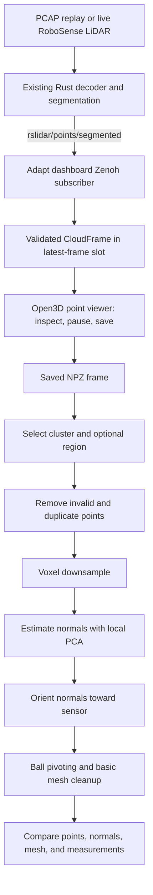

# Mesh visualization v1 overview

## Goal and scope

Capture a segmented RoboSense LiDAR sweep, select a cluster, and inspect how
downsampling, normal estimation, and surface reconstruction affect its mesh.
Use Python, NumPy, and Open3D. Process one saved sweep at a time initially;
continuous meshing, cross-frame tracking, and accumulated maps are later work.

## Current implementation

Step 1 is implemented in `mesh_vis/`. Step 2 is implemented except the
measurements and saving in 2.4. Use `python3 -m mesh_vis capture`,
`python3 -m mesh_vis inspect FILE.npz`, and `python3 -m mesh_vis mesh FILE.npz --cluster ID`.
See the [README](../README.md) for commands and desktop acceptance checks.
The earlier sandbox is preserved under `experiments/legacy/`.

Save requests retain the selected frame at the keypress. Decoding accepts any
valid segmented record count; ring/block layout is not inferred. Publisher
`dense_points` metadata defaults to unknown and can be configured explicitly.
`--expected-records` (alias `--full-records`) is only a diagnostic; zero disables
it everywhere. Version-2 snapshots represent unknown settings and the loader
continues to accept version-1 snapshots.

## System flow

## Step 1 — Reuse the subscriber; add inspection and capture

### 1.1 Extract the existing dashboard implementation

Reuse these sources from the neighboring Autonomy Dashboard repo:

- [LidarSubscriber](../../Autonomy%20Dashboard/igvc-dashboard%20/backend/subscribers/perception.py):
  subscription, payload decoding, lock-protected latest-frame storage, and unsubscribe.
- [ZenohClient](../../Autonomy%20Dashboard/igvc-dashboard%20/backend/zenoh_client.py):
  session startup/shutdown, `LIDAR_ZENOH_KEY`, and `ZENOH_CONFIG` support.
- [Subscriber tests](../../Autonomy%20Dashboard/igvc-dashboard%20/tests/test_lidar_zenoh.py):
  publisher-compatible fixtures and isolated Zenoh integration checks.

Copy/adapt the LiDAR-specific pieces into a standalone module; the source files
also import ROS, camera, and dashboard code that mesh-vis does not need.
Reuse configurable connectivity, but choose endpoints for the actual deployment;
the dashboard's Docker-specific hostname is not a universal default.

### 1.2 Adapt decoding to a typed frame

The existing wire format is little-endian: a 16-byte header
`(int32 seconds, uint32 nanoseconds, uint32 count, uint32 point_step)`, followed
by 20-byte segmented records `(float32 x, y, z, intensity, int32 cluster_id)`.

- Return separate `xyz: N×3 float32`, `intensity: N float32`, and
  `cluster_id: N int32` arrays, plus integer timestamp fields and a local sequence.
- The dashboard reads each record as floats and recovers labels by reinterpreting
  the fifth column's bits. Decode labels directly as little-endian integers here;
  a numeric float-to-int conversion would corrupt them.
- Require the segmented record size for this workflow; validate header and payload
  length. Malformed messages must not replace the last valid frame.
- Preserve received arrays in snapshots; filter nonfinite XYZ for viewing and
  reconstruction. The dashboard currently drops NaNs during decoding and does not
  exclude infinities. Apply any filtering mask consistently across all arrays.
- Store configured `frame_id="rslidar"`, units in metres, and
  `sensor_origin=[0, 0, 0]`; these are assumptions, not transmitted metadata.
- Treat `cluster_id=-1` as unassigned, not ground. IDs are local to each frame.

### 1.3 Add the capture viewer and persistence

- Retain the subscriber's single latest-frame slot; perform GUI updates on the
  main thread. Keep reconstruction out of the callback.
- Show cluster colors, gray unassigned points, axes, counts, and a stable camera.
- Support pause/resume and saving the currently displayed frame.
- Save the full frame to `.npz`, including a format version, source key, and frame
  metadata. Use unique filenames because replay can repeat source timestamps.
- Reopen snapshots without Zenoh. Use local monotonic timing for processing;
  historical replay timestamps do not measure current latency.

**Done when:** PCAP replay displays correctly, a snapshot reloads with identical
arrays and labels, and malformed input leaves the previous frame intact. Adapt
the existing decoder/integration checks and add snapshot round-trip coverage.

## Step 2 — Reconstruct and inspect a saved cluster

1. Load one saved sweep. Each point has x, y, z, intensity and a cluster id from the segmenter.
2. Keep only the chosen cluster's points, and drop points with missing (NaN) coordinates.
3. Remove points that are exact copies of another point. Our frames have none, but some lidar settings produce them.
4. Measure the spacing s: for every point, find the distance to its nearest neighbour, and take the median. All later sizes are multiples of s, so the same settings work for near and far objects and for different lidars.
5. Voxel downsample with cubes of 3 × s. Each occupied cube is replaced by the average of its points. This thins the points along each beam but leaves the beams separate. Then measure the spacing again on the result, calling it s′.
6. Estimate normals. For each point, take its neighbours within 6 × s′ (at most 50) and fit a plane to them; the normal is perpendicular to that plane. Then flip each normal so it points toward the sensor. The radius is 6 × s′ because smaller radii often reach only points on the same beam, which lie on a line, and a plane through a line can point any direction.
7. Ball pivoting with balls of radius 1.5, 3 and 6 × s′. A ball resting on three points makes a triangle, then rolls over each edge onto the next point to make the next triangle. Small balls run first and keep detail; larger balls then fill the gaps the small ones fell through. Every corner of every triangle is one of the downsampled points.
8. Remove duplicate triangles, triangles with zero area, and vertices no triangle uses.
9. Remove triangles with any edge longer than 6 × s′. These are usually bridges across gaps with no real surface.
10. Find the separate connected pieces of the mesh, and remove pieces with fewer than 10 triangles.
11. Smooth the mesh with 10 passes of Taubin smoothing. Each pass moves every vertex toward the average of its neighbours, then pushes it back out slightly so the mesh doesn't shrink. This removes the crinkling caused by range noise.
12. Compute vertex normals so the mesh shades properly when displayed.

The edge-cutoff default is undecided: it removes false bridges across the bus windows but also real surface on the sparse truck cab.

Remaining: save the mesh with its frame, cluster id and settings, and report
median/p95 distance from the original points to the mesh.

Known limits: a single sweep from a static sensor leaves gaps between beams, has no returns from glass, and does not see the far side of objects. Cleanup cannot fill these; a moving sensor with fused scans (e.g. TSDF fusion) can.

## Implementation layout and order

- `mesh_vis/frame.py`: frame representation and snapshot save/load.
- `mesh_vis/zenoh_source.py`: adapted subscriber, decoder, and session lifecycle.
- `mesh_vis/reconstruct.py`: pure offline pipeline and parameters.
- Extend `mesh_vis/view.py` for inspection; add pipeline metrics when reconstruction starts.
- `mesh_vis/__main__.py`: `capture`, `inspect`, and `mesh` commands.
- `tests/`: active pipeline tests; `experiments/legacy/`: preserved playground and its tests.

Implement in this order: adapt decoder and snapshot round-trip → capture viewer
→ saved-cluster selection → downsampling and normal inspection → ball pivoting
and comparison views. Record the working dependency versions, including
`eclipse-zenoh`, for reproducible experiments.
